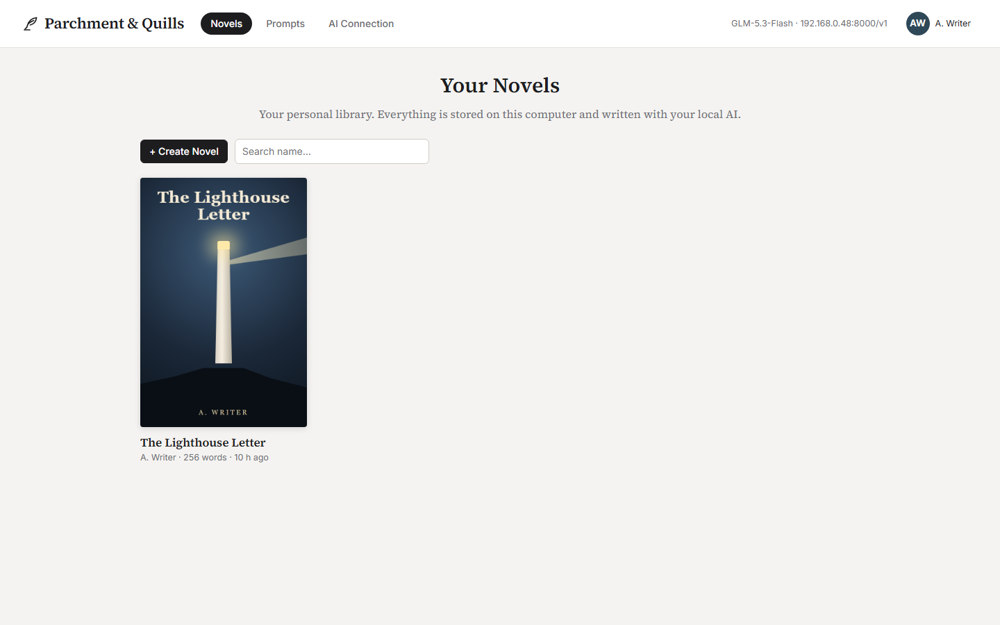
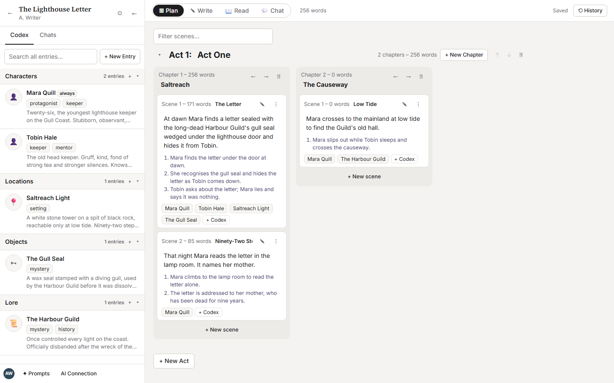
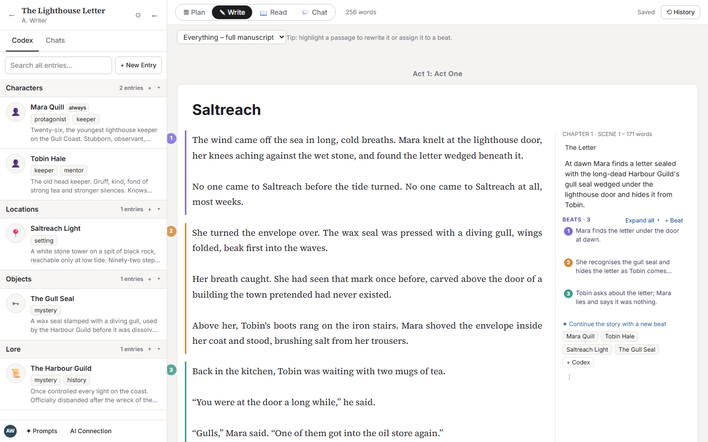
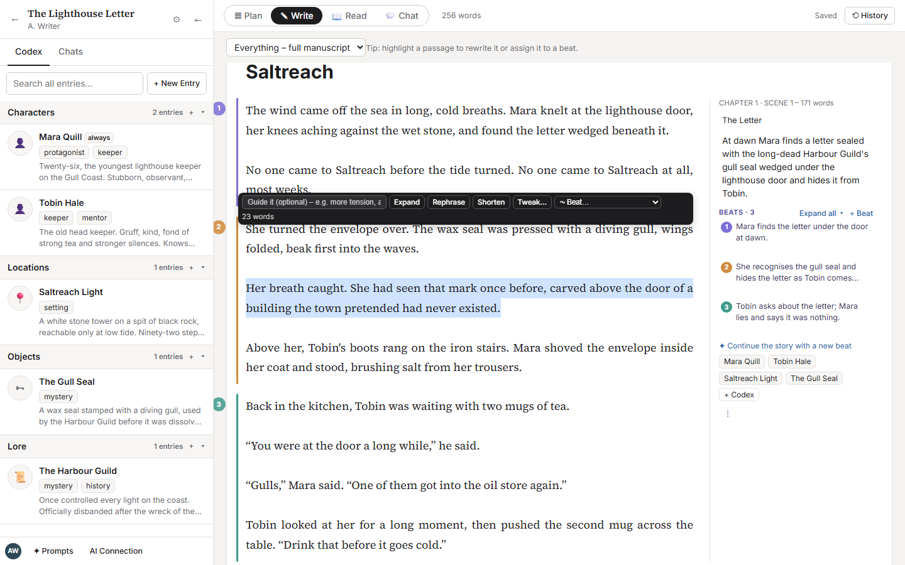
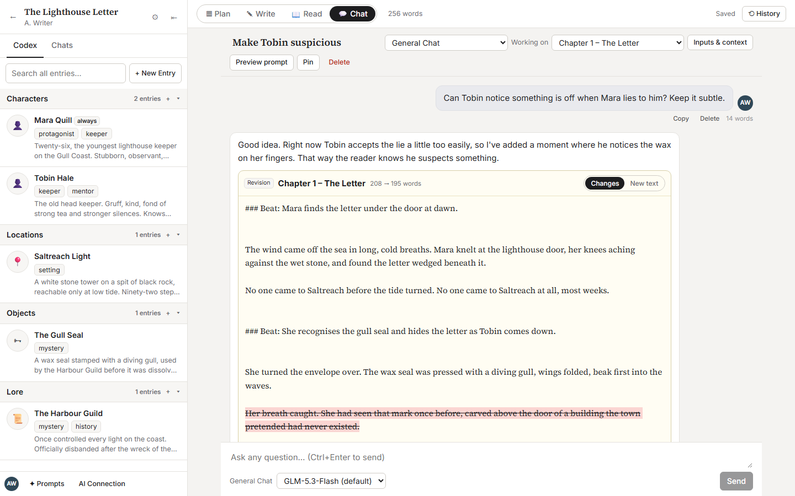
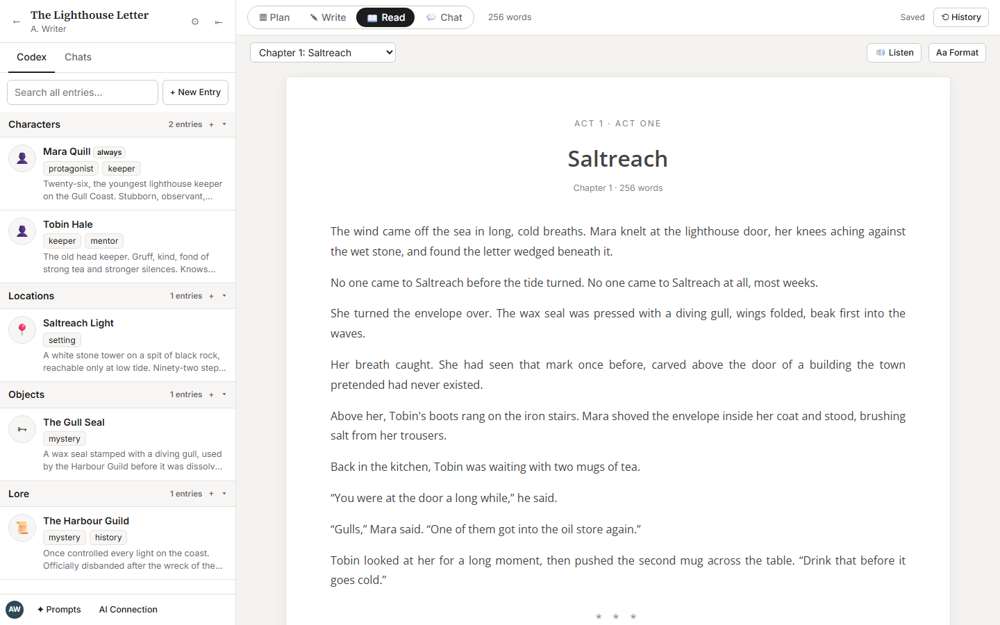
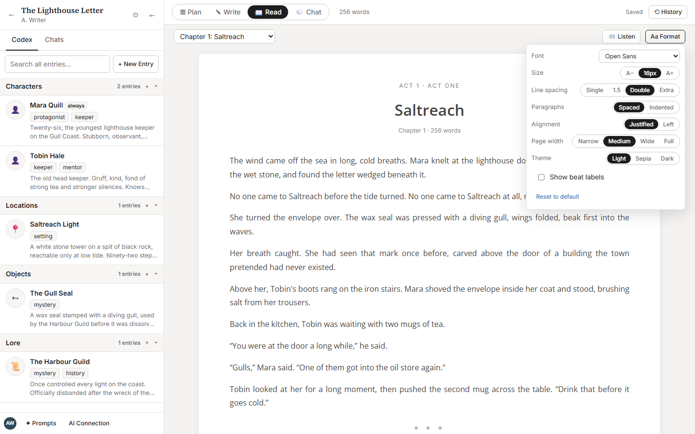

# Parchment & Quills

A local, self-hosted novel-writing app in the style of NovelCrafter. It works with your own
OpenAI-compatible AI server (vLLM, LM Studio, Ollama, …) and keeps every book on your own computer.
It includes a codex, story beats, version history, an AI workshop chat that can revise scenes,
a reader mode inspired by the one found on FimFiction, and a read-aloud with a voice per character. 
This takes two great services and tailors those experiences into a more specific experience.

Full documentation is in [app/README.md](app/README.md).

## Quick start

Double-click **`Start Parchment and Quills.cmd`**. It installs and builds the app on first run, then starts
the server on port 8787, which other computers on your home network can also reach. Set your AI server under
**AI Connection**.

```
cd app
npm install
npm run build
npm start
```

## Screenshots

*The screenshots use a short demo story, "The Lighthouse Letter".*

### Library
Your novels, each with its own cover.



### Plan
Acts, chapters, and scene cards, each with a summary, beats, and codex mentions. The codex sidebar is on the left.



### Write
The manuscript editor. Each beat's section has a coloured edge. The side panel lists the scene's beats: click one to jump to its text, or have the AI continue the story from it.



### Rewrite a passage or assign it to a beat
Highlight text to **Expand**, **Rephrase**, or **Shorten** it, with an optional guide for the AI. You can also attach the highlighted text to a beat.



### Chat that edits your story
Choose a chapter or scene under **Working on** and ask for changes. The AI replies with a revision card that shows a word-level diff. **Commit to scene** saves a history version first, then applies the change.



### Read
A FimFiction-style reader (Open Sans, double-spaced). **🔊 Listen** reads the chapter aloud.



### Reading format
Font, size, line spacing, paragraph style, alignment, page width and theme.


